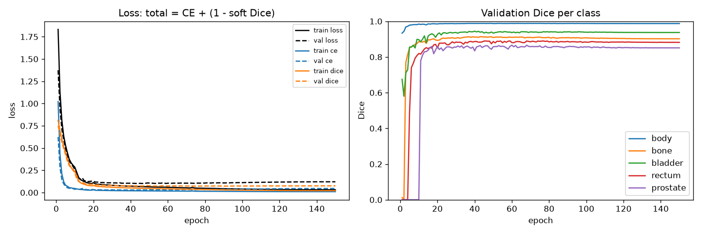
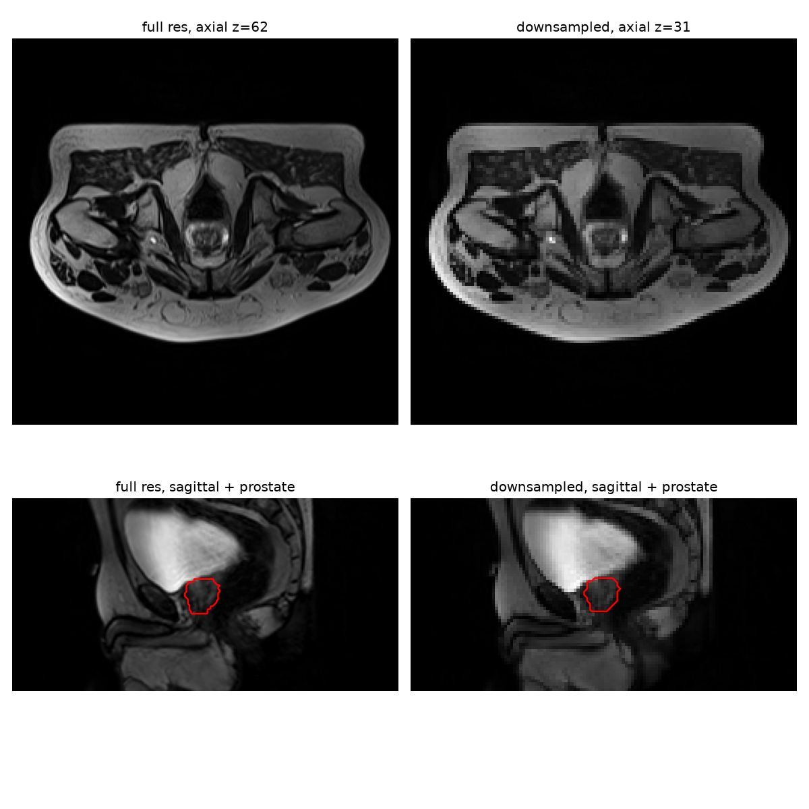
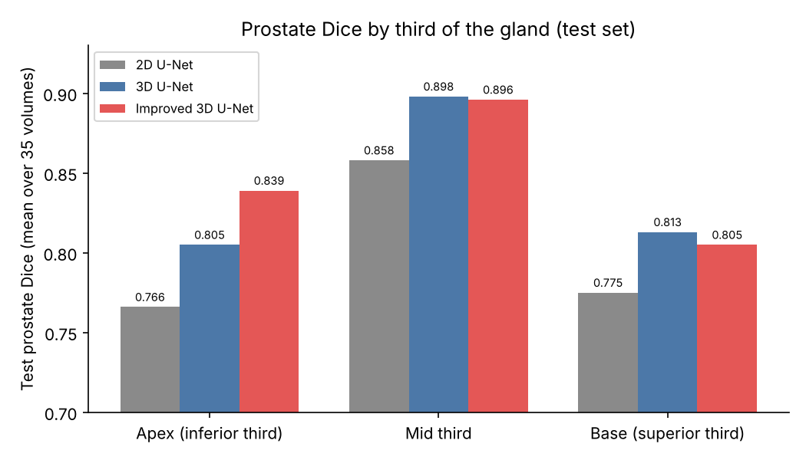
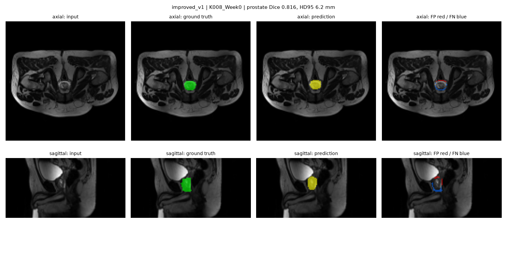
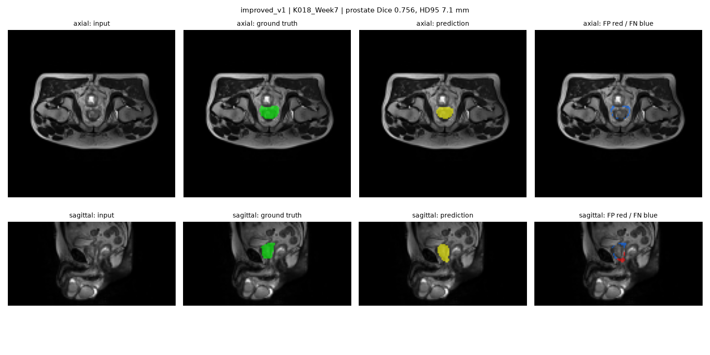
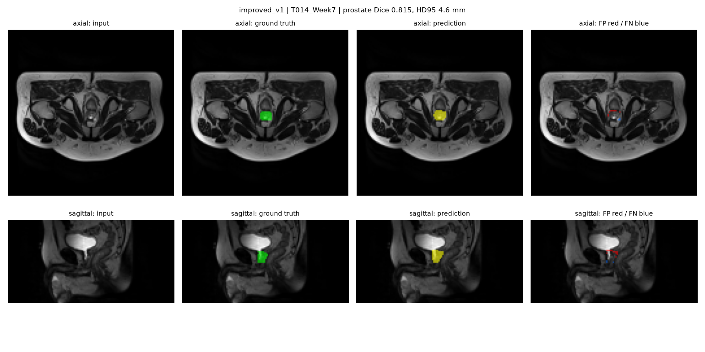
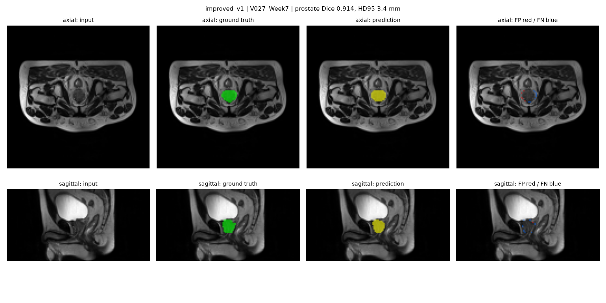
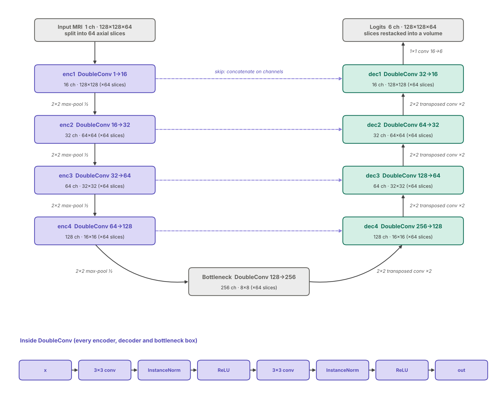
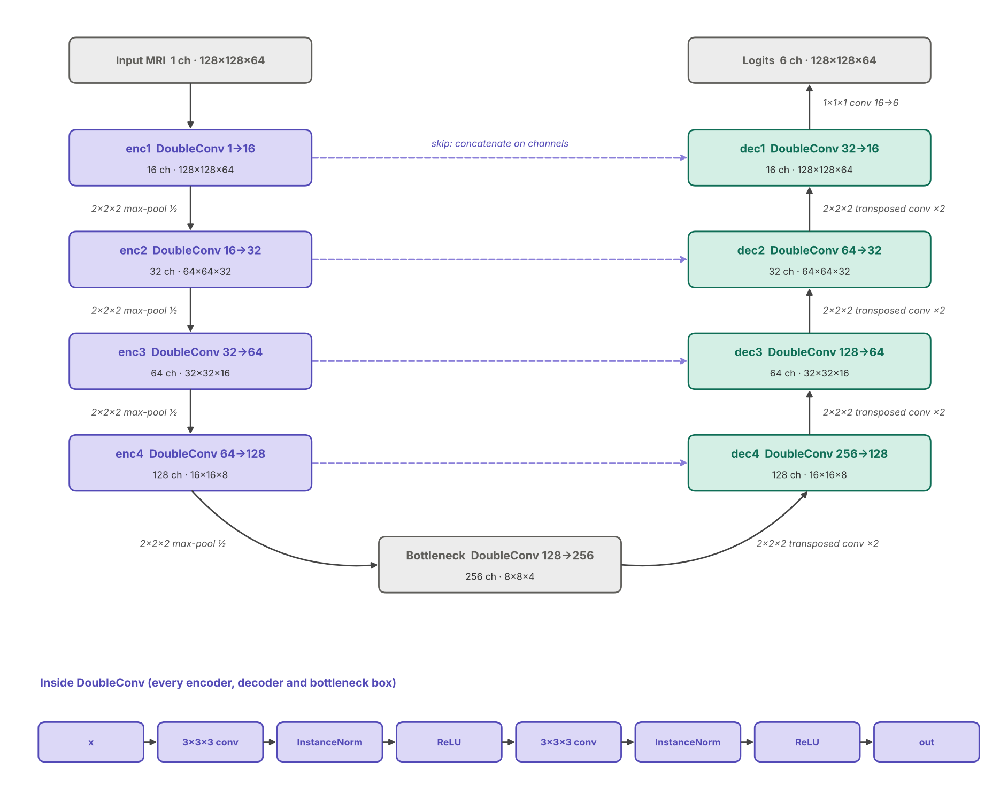
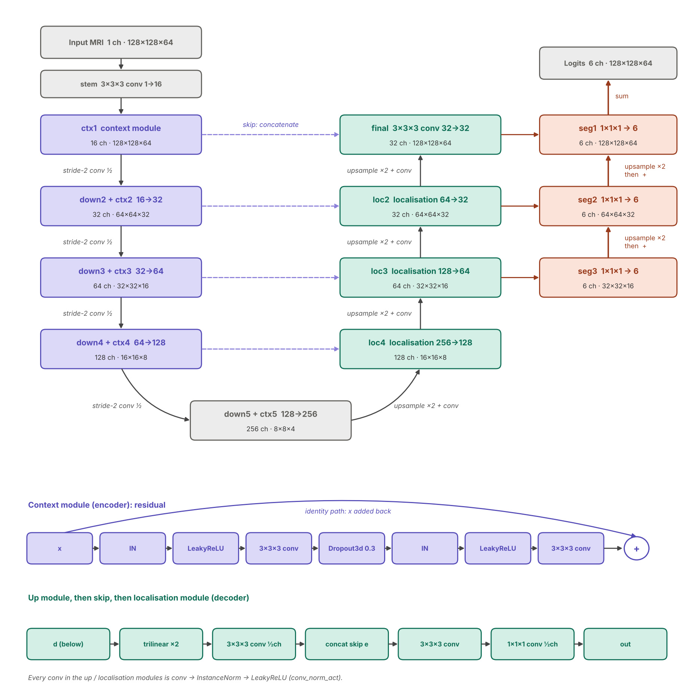

# Prostate Segmentation of 3D Pelvic MRI: 2D vs 3D vs Improved 3D U-Net

Angus Slater (49615878)

COMP3710, The University of Queensland

October 30th, 2026

## 1. Problem and User 

Prostate radiotherapy planning requires precise segmentation of the clinical target
(prostate) and the surrounding organs at risk (OAR: bladder, rectum, and bone). Once
segmented, the selected area then receives a planned radiation dose to kill the unhealthy
cells. If the segmentation boundaries leak into surrounding tissue the patient can suffer
severe proctitis or cystitis. If the segmentation omits cancerous cells, the patient can
experience a relapse or metastasis.

The contouring of the prostate boundaries is conventionally performed by a radiation
oncologist, who oversees treatment and ensures safety throughout the therapy (David
Geffen School of Medicine at UCLA, n.d.). Building a machine learning (ML) model to
segment prostates could help reduce contouring time and variability between clinicians. A
model would be used in conjunction with an oncologist to ensure appropriate decisions are
made for each case.

The engineering problem stems from the composition of HipMRI scans in which the prostate
gland can account for ~0.1% of total volume. Further, the base and apex blend into the
bladder neck and pelvic floor and the voxels are partial-volume. This makes cross-entropy
loss alone insufficient as it is dominated by background, and global Dice limited as it
fails to precisely capture boundaries and is instead inflated by the easily predicted
central part of the prostate.

The report details the implementation of a control 2D U-Net segmentation model with no
inter-slice context (Ronneberger et al., 2015), a baseline 3D U-Net model based on the
paper from Çiçek et al. (2016), and an improved 3D U-Net based on the development by
Isensee et al. (2018). To address the problems associated with the task, these models
were evaluated on per-class Dice, per-third Dice, 95th-percentile Hausdorff distance
(HD95), resource cost (parameters, training time, and VRAM) and a failure autopsy.

The goal of the report is to determine if 3D context and the improved 3D U-Net design
reduce base / apex errors, or only improve the prediction of the centre of the prostate,
and if these improvements are sufficient to warrant the increased computational cost.

Table 1 summarises the key results. 3D context is worth its cost: it raises test prostate
Dice by 0.055 and lowers HD95, for ~1.4–1.7× the training time. The Improved 3D U-Net is
recommended, mainly for its better apex and more consistent HD95, but its overall gain
over the 3D baseline is small, and every model still needs clinician review at the base
and apex.

Table 1. Key results (test set; validation mean ± std over 3 seeds)

| Model | Val prostate Dice | Test prostate Dice | Apex / Mid / Base Dice | HD95 (mm) | Train time | Inference |
| --- | --- | --- | --- | --- | --- | --- |
| 2D U-Net | 0.836 ± 0.004 | 0.787 | 0.766 / 0.858 / 0.775 | 6.8 ± 3.0 | 10.0 min | 11 ms |
| 3D U-Net | 0.868 ± 0.002 | 0.842 | 0.805 / 0.898 / 0.813 | 5.3 ± 2.3 | 13.6 min | 23 ms |
| Improved 3D U-Net | 0.870 ± 0.001 | **0.849** | **0.839** / 0.896 / 0.805 | **4.7 ± 1.3** | 16.9 min | 27 ms |

## 2. Feasibility Review

### 2.1 User, scope and acceptance criteria

**User.** A radiotherapy planner contouring the prostate and organs at risk on pelvic
MRI. The prototype drafts 3D contours for review, not sign-off, since boundary errors
near the rectum or bladder change the dose those organs receive.

**Scope.** HipMRI 3D T2 MRI, 6 labels, downsampled to 128×128×64. Question: does 3D
context (and the Improved U-Net's design) reduce prostate errors at the base and apex,
not just in central slices?

**Acceptance criteria.**

1. Test prostate Dice ≥ 0.70 (Improved 3D U-Net).
2. Base/apex per-slice prostate Dice no worse than the baseline.
3. Prostate HD95 (mm) reported and compared with the baseline.
4. No patient in more than one split.
5. Peak VRAM ≤ 16 GB (fits a clinic workstation GPU); training ≤ 1 h;
   inference < 1 s/volume.


### 2.2 Model choice and course concepts

**Data.** 211 volumes / 38 patients, z-scored per volume, 2× downsampled, split by
patient 141/35/35 volumes (24/7/7 patients) so weekly re-scans cannot leak into test.

**Baseline:** 3D U-Net (Çiçek et al., 2016): max-pool down, transposed conv up,
concatenated skips, 5.6M params. **Proposed (Hard):** Improved 3D U-Net (Isensee et al.,
2018): residual context modules with dropout, stride-2 conv downsampling, LeakyReLU, deep
supervision, 9.5M params.

**Course concepts.** Skip connections restore "where" lost by pooling; 3×3×3 kernels see
neighbouring slices (the base/apex question); residual connections ease gradient flow
(ResNet); deep supervision gives deep decoder levels a direct loss signal; soft Dice + CE
handles the 0.1% prostate class.

### 2.3 Preliminary feasibility evidence

Data audit: 256×256×128 volumes (one 144-slice scan cropped), 1.41–1.88 mm in-plane /
1.56 mm slices, LPS orientation for all 211, labels 0–5, prostate 0.10% of voxels. No
patient overlap (asserted in `dataset.py`).

Seed-42 results at the time of the feasibility check-off (final 3-seed results in Section
6).

| Model (seed 42)     | Best val prostate Dice | Train time | Peak VRAM |
| ------------------- | ---------------------- | ---------- | --------- |
| 3D U-Net (baseline) | 0.866 (epoch 60)       | 13.3 min   | 1.38 GB   |
| Improved 3D U-Net   | 0.872 (epoch 97)       | 16.6 min   | 2.36 GB   |



*Figure 1: Baseline. Prostate Dice is 0 until ~epoch 10 (CE dominates); mild overfitting
after ~epoch 60. The Improved model finds the prostate by ~epoch 3 and its val loss does
not rise.*

### 2.4 Risks, budget and fallback

**Risks.** (1) Global Dice score hides boundary failures: both models already exceed
0.70, so the Improved model may not beat the baseline's 0.866 overall yet still differ at
the base and apex; judge on per-slice Dice (base/mid/apex) and HD95. (2) One seed per
model: +0.006 may be noise; 3 seeds each are running. (3) 2× downsampling blurs the
prostate boundary; VRAM headroom (2.4 of 40 GB) makes full-resolution crops feasible.

**Budget.** ~15 min per 150-epoch run on one A100; ~15 runs (3 seeds × 2 models plus
ablations) is about 4 GPU-hours. Queue time, not GPU time, is the constraint.

**Next experiment.** Evaluate both models once on the test set: per-class Dice, per-slice
prostate Dice and HD95, plus 3–5 failure cases.

**Fallback.** The baseline 3D U-Net (Normal tier) is trained and reproducible, so a
complete submission already exists.

## 3. Data and Preprocessing

Data were provided by the HipMRI Study (Dowling & Greer, 2021). It comes from the HipMRI
study, a prostate radiotherapy study in which patients were scanned with MRI each week
during treatment (Dowling et al., 2015). Labels are segmented in 3D by an MR physicist
with over 10 years' experience and include background, body, bone, bladder, rectum, and
prostate (~0.1% volume) (task sheet Appendix A). It was accessed through the course copy
on Rangpur at `/home/groups/comp3710/HipMRI_Study_open/` (`semantic_MRs`,
`semantic_labels_only`).

The task required downsampling of the original image but did not specify a method. As the
voxels are nearly cubic (about 1.4-1.9 mm in-plane, 1.56 mm between slices), the images
were first downsampled by 2x on every axis (256 x 256 x 128 to 128 x 128 x 64, one image
was also cropped at the head (far from prostate) as its initial size was 256 x 256 x
144). This gave 8x fewer voxels and a ~8x decrease in computation per epoch. Downsampling
was done in `load_volume()` in the `dataset.py` file by first normalising the image
(z-score) then resizing with `torch.nn.functional.interpolate`: trilinear for the image
(each voxel is a smooth weighted blend of nearby originals), and nearest for labels (so
labels stay as whole class IDs, no decimals). Figure 2 shows an example of a downsampled
image against its corresponding original. Downsampling was required by the task, however,
it means voxels are of size ~3.1mm (length) and prostate boundaries appear more
block-like. `inspect_data.ipynb` explores one example scan (B040_Week0): label meanings, class
fractions, voxel spacing and the downsampling check in Figure 2. The dataset-wide audit
in Section 2.3 (counts, shapes, spacing, orientation) was run on Rangpur.



In all there were 211 scans across 38 patients, with a median of 8 scans per patient (min
1, max 8). 22 patients have the full 8 weekly scans. The data was split into train,
validation, and test sets by patient (shuffled, fixed seed ~70 / 15 / 15 split). As
week-to-week scans for a given patient are near identical, splitting by volume would risk
the model being able to identify and learn specific patients, possibly leading to
overstated success in testing (if a patient's scans happened to be present in both the
train and test sets). No patient appears in more than one split (asserted in code).
Validation selected the best checkpoint; the test set is evaluated once. Table 2
quantifies the split. The pre-made train/validation/test split discussed on Ed applies
only to the 2D `keras_slices_data`; the 3D volumes used here are not pre-split, so the
patient-level split was made in `dataset.py`.

Table 2. Train, validation, and test split composition

| Split       | Patients | Volumes (scans) | % of volumes |
| ----------- | -------- | --------------- | ------------ |
| Train       | 24       | 141             | 66.8%        |
| Validation  | 7        | 35              | 16.6%        |
| Test        | 7        | 35              | 16.6%        |
| **Total**   | **38**   | **211**         | **100%**     |

## 4. Models

A 2D control U-Net (Ronneberger et al., 2015), base 3D U-Net (Çiçek et al., 2016) and an
improved 3D U-Net (Isensee et al., 2018) were all trained on the HipMRI data. They share
the encoder-decoder (U) shape: 4 down-sampling levels, channels 16 -> 32 -> 64 -> 128 ->
256, skip connections concatenated on channels, and a 1x1(x1) output convolution. They
also share InstanceNorm (batch size 2 makes BatchNorm's batch statistics unreliable), and
the identical loss and training setup, so architecture is the only variable.

See Appendix A for an AI-generated model architecture diagram for all three models. 

### 4.1 Control 2D U-Net

The 2D U-Net serves as a control. It has no inter-slice context, so comparing it with the
3D models isolates the value of the 3D context. The volume is split into 64 axial slices,
each segmented independently (meaning no continuity across axial slices), prediction
restacked into (B, 6, 128, 128, 64).

The 4 downsampling layers and bottleneck of the 2D U-Net have a double convolution
structure, where this process is repeated twice per layer:

1. 3x3 convolution (stride 1)
2. InstanceNorm 
3. ReLU 

Between encoder layers, a 2x2 max-pool halves the height and width (slices never pooled
together).

This takes the number of channels from 1 to 256 at the bottleneck, where the data has the
shape (B x 64, 256, 8, 8). From here it is passed to the decoder, which involves four
decoder levels, each:

1. 2x2 Transposed convolution (halves the channels, doubles height and width) 
2. Concatenate with the matching encoder level's output (skip connections)
3. Double convolution (3 steps from above, twice)

After this the data undergoes a final 1x1 convolution and restack into a volume to get a
6 channel output (one for every label). The model has 1,942,374 parameters, fewer than
the 3D models due to the 9 vs 27 kernel weights.

The 2D model uses the same widths, loss, data, and steps as the 3D models. The loss is
computed on the restacked volume.

### 4.2 Baseline 3D U-Net

Same as 4.1 except: 
- The standard 3D baseline from Çiçek et al. (2016), the established reference for
  volumetric segmentation that the Improved model is compared against.
- Processes the whole volume at once: (B, 1, 128, 128, 64) giving inter-slice context.
- Encoder has 3x3x3 convolutions with the same double convolution structure as the 2D
  model.
- a 2x2x2 max-pool between encoder levels halves all three axes, so the bottleneck is (B,
  256, 8, 8, 4).
- Decoder has the same 4 levels with 2x2x2 transposed convolutions, concatenated skips,
  then the double convolution.
- Output is a 1x1x1 convolution to 6 channels: (B, 6, 128, 128, 64), there is no
  restacking since it is already a volume.
- Parameters: 5,646,470 (more than 2D because each 3×3×3 kernel has 27 weights vs 9).
- Unlike the model from Çiçek et al. the model uses InstanceNorm instead of BatchNorm,
  widths starting at 16 instead of 32, and 4 pooling levels instead of 3.

Because the 3x3x3 kernels and the 2x2x2 pooling span the slice axis, the model can use
information from neighbouring slices, which is the property the 2D control lacks.

### 4.3 Improved 3D U-Net

The proposed model, following Isensee et al. (2018). It keeps the overall layout of the
3D U-Net in 4.2 (whole-volume input, four levels, 16 → 256 channels, bottleneck
(B, 256, 8, 8, 4)), except:

- **Stem:** a single 3x3x3 convolution lifts the input from 1 to 16 channels before any
  residual block, because a residual addition needs input and output of the same shape.
- **Context modules (encoder):** each level is a residual block, `x + block(x)`, where
  block = InstanceNorm → LeakyReLU → 3x3x3 conv → Dropout3d(0.3) → InstanceNorm →
  LeakyReLU → 3x3x3 conv. The identity path lets gradients bypass the convolutions (He 
  et al., 2016), so each block only learns a correction to its input. Dropout3d zeroes 
  ~30% of feature maps at random during training to reduce overfitting.
- **Stride-2 3x3x3 convolutions** replace max-pooling between levels, so downsampling is
  learned rather than a fixed rule.
- **Decoder:** each level upsamples with trilinear interpolation (x2) followed by a 3x3x3
  convolution that halves the channels, instead of a transposed convolution (avoiding
  checkerboard artefacts). The skip connection is then concatenated and merged by a
  **localisation module**: a 3x3x3 convolution followed by a 1x1x1 convolution that
  halves the channels cheaply.
- **Deep supervision:** 1x1x1 segmentation heads produce 6-class maps at three decoder
  levels (1/4, 1/2 and full size). Each coarse map is upsampled and added to the next
  finer one, and the sum is the output. This gives the deeper decoder levels a short,
  direct path from the loss. It differs from a skip connection, which carries encoder
  *features* across the U; deep supervision sends decoder *predictions* to the output.
- **LeakyReLU** (slope 0.01) replaces ReLU throughout, so negative inputs keep a small
  gradient and units cannot "die".

The output is (B, 6, 128, 128, 64), and the model has 9,463,202 parameters (~9.5M).

## 5. Training Setup 

All three models were trained with an identical setup (`train.py`), so that architecture
is the only variable.

| Setting | Value |
| --- | --- |
| Loss | Dice + cross-entropy (`DiceCELoss`): CE + (1 − soft Dice averaged over the 6 classes) |
| Optimiser | Adam, `lr = 1e-3` |
| LR schedule | Cosine annealing from 1e-3 to ~0 over 150 epochs |
| Batch size | 2 volumes |
| Precision | bf16 autocast; loss computed in fp32 |
| Model selection | Checkpoint with the best validation prostate Dice |
| Seeds | Training seeds 42, 1, 2 per model; patient split fixed (`split_seed = 42`) |
| Hardware | One NVIDIA A100 (Rangpur) |

CE gives smooth, stable gradients from the first epoch, but on its own it is dominated by
the background; the soft Dice term (Milletari et al., 2016) weights each class equally,
so the ~0.1% prostate class counts as much as the background. Together they give stable
early training and class balance. Adam (Kingma & Ba, 2015) uses momentum and a per-weight
adaptive step size, which makes it the standard choice for U-Nets and robust without
tuning. Cosine annealing (Loshchilov & Hutter, 2017) reduces the step size over training
so the weights settle into a minimum. InstanceNorm (Ulyanov et al., 2016) normalises each
scan separately, which is stable at a batch size of 2. The epoch with the best validation
prostate Dice (between 20 and 97 across runs) was kept as the final checkpoint; the test
set was never used for selection. bf16 autocast roughly halves activation memory and
speeds up training on the A100, while the loss is computed in fp32 for numerical
precision. For the 2D model the loss is computed on the restacked volume, so all three
models receive an identical training signal. All models were implemented in PyTorch
(Paszke et al., 2019).

## 6. Results

### 6.1 Validation (3 training seeds per model)

| Model | Val prostate Dice (mean ± std) | Best epochs | Train time | Peak VRAM (train) | Params |
| --- | --- | --- | --- | --- | --- |
| 2D U-Net | 0.836 ± 0.004 | 20, 26, 66 | 10.0 min | 1.82 GB | 1.9M |
| 3D U-Net | 0.868 ± 0.002 | 32, 60, 75 | 13.6 min | 1.38 GB | 5.6M |
| Improved 3D U-Net | 0.870 ± 0.001 | 81, 83, 97 | 16.9 min | 2.36 GB | 9.5M |

Moving from 2D to 3D adds +0.032 validation prostate Dice (~10x the seed-to-seed spread);
the Improved model adds only +0.002 over the 3D baseline, within seed noise. The best
epoch rises with model complexity: the 2D model peaks earliest and then overfits, while
dropout and deep supervision let the Improved model keep improving until epochs 81–97.

### 6.2 Test set (35 volumes, 7 patients; evaluated once)

| Class | 2D U-Net Dice / IoU | 3D U-Net Dice / IoU | Improved 3D Dice / IoU |
| --- | --- | --- | --- |
| Body | 0.982 / 0.965 | 0.986 / 0.972 | 0.987 / 0.975 |
| Bone | 0.910 / 0.835 | 0.921 / 0.855 | 0.925 / 0.862 |
| Bladder | 0.912 / 0.845 | 0.929 / 0.874 | 0.938 / 0.888 |
| Rectum | 0.825 / 0.709 | 0.858 / 0.756 | 0.866 / 0.767 |
| **Prostate** | **0.787 ± 0.072 / 0.655** | **0.842 ± 0.051 / 0.730** | **0.849 ± 0.044 / 0.740** |
| Prostate HD95 (mm) | 6.8 ± 3.0 | 5.3 ± 2.3 | 4.7 ± 1.3 |

All three models meet the ≥ 0.70 prostate Dice target. 3D context improves every class,
most for the small, low-contrast structures (prostate +0.055, rectum +0.033), and reduces
both the mean and the spread of prostate HD95. IoU is computed per volume as Dice / (2 −
Dice).

### 6.3 Base and apex: the boundary dilemma

| Prostate Dice by third | Apex | Mid | Base |
| --- | --- | --- | --- |
| 2D U-Net | 0.766 | 0.858 | 0.775 |
| 3D U-Net | 0.805 | 0.898 | 0.813 |
| Improved 3D U-Net | **0.839** | 0.896 | 0.805 |



The 2D and 3D U-Nets are ~0.08–0.09 Dice worse at both the apex and the base than in the
middle of the gland, which the global Dice score hides. The Improved model narrows the
apex gap to ~0.06, but its base gap remains ~0.09. 3D context raises all three thirds by
a similar amount (~+0.04), so it improves the model overall but does not by itself close
the gap at the ends. The Improved model's only clear gain over the 3D baseline is at the
apex (+0.034); its base is no better.

### 6.4 Resources

| Model | Params | Train time (150 ep) | Peak VRAM train | Inference / volume | Peak VRAM inference |
| --- | --- | --- | --- | --- | --- |
| 2D U-Net | 1.9M | 10.0 min | 1.82 GB | 11 ms | 0.34 GB |
| 3D U-Net | 5.6M | 13.6 min | 1.38 GB | 23 ms | 0.32 GB |
| Improved 3D U-Net | 9.5M | 16.9 min | 2.36 GB | 27 ms | 0.48 GB |

At this downsampled resolution, 3D costs ~1.4–1.7x the 2D training time and far less than
the "5–10x" the task anticipated; the 3D baseline even uses less training memory than the
2D model, because the 2D network keeps all 64 slices at every level while 3D pooling also
halves the slice axis. All models infer in under 30 ms per volume on one A100.

## 7. Failure autopsy

Five test volumes were examined: the four with the lowest prostate Dice, plus the best
case (V027_Week7) for contrast. Each figure shows an axial and a sagittal slice through
the prostate: input | ground truth (green) | prediction (yellow) | error map (red = false
positive, blue = false negative). In the sagittal view, anterior is left and superior
(base, towards the bladder) is up. Figures for all three models are in
`figures/overlay_<model>_<case>.png`; the Improved model's figures are shown below.

| Case | 2D Dice / HD95 | 3D Dice / HD95 | Improved Dice / HD95 | Failure mode |
| --- | --- | --- | --- | --- |
| K008_Week0 | 0.769 / 10.6 mm | 0.776 / 8.7 mm | **0.816 / 6.2 mm** | Apex missed, base over-extended |
| K018_Week7 | 0.693 / 7.8 mm | **0.773 / 7.1 mm** | 0.756 / 7.1 mm | Whole gland under-segmented |
| T014_Week2 | 0.671 / 9.4 mm | 0.763 / 6.2 mm | **0.790 / 6.2 mm** | Bleeds into bladder neck, apex missed |
| T014_Week7 | 0.736 / 7.1 mm | 0.758 / 6.2 mm | **0.815 / 4.6 mm** | Bleeds into bladder neck, apex missed |
| V027_Week7 | 0.876 / 3.4 mm | **0.926 / 3.1 mm** | 0.914 / 3.4 mm | Success: one-voxel boundary rim only |

### 7.1 K008_Week0: prediction shifted towards the base



All three models place the gland too far superiorly: there is a band of false
negatives across the inferior apex and a thinner false-positive cap at the base,
next to the bladder. The 2D model also predicts a separate island of prostate near
the bladder neck, several slices above the gland. That single blob drives its HD95
to 10.6 mm. The blob is the kind of error a slice-by-slice model makes, because no slice
"knows" the gland ended below it. The 3D models remove the island, and the Improved
model shrinks the apex miss (HD95 10.6 → 8.7 → 6.2 mm), matching its apex gain in
Section 6.3.

### 7.2 K018_Week7: systematic under-segmentation



This is a large gland in a low-contrast scan. Every model draws it too small: the axial
error map is an almost continuous blue ring, and in sagittal the base is cut off (blue,
top) while the prediction pokes slightly below the true apex (red, bottom). The gland
edge blends into the surrounding tissue, so the models fall back on a "typical"
prostate size learned from training data. Two cases fall below the 0.70 target, both 
from the 2D model (T014_Week2, 0.671; K018_Week7, 0.693). K018 is also the only failure 
case where the Improved model is worse than the 3D baseline (0.756 vs 0.773). Deep 
supervision rewards getting the coarse shape right, which may pull predictions towards 
an average-sized gland.

### 7.3 T014 (Weeks 2 and 7): small gland next to the bladder neck



Patient T014 provides two of the five worst cases. The gland is small and sits directly
under a bright, fluid-filled bladder neck. In both scans the models continue the
prostate upwards into the bladder neck (red at the top of the sagittal view) and miss
part of the apex (blue at the bottom). A small gland is hit hardest: a one-voxel (~3 mm)
boundary error is a large fraction of its volume, so Dice falls quickly.
The failure appears in Week 2 and Week 7, so it follows the patient's anatomy rather
than the stage of treatment. The 2D model is worst (0.671 at Week 2); the Improved
model is best on both scans and cuts HD95 to 4.6 mm at Week 7.

### 7.4 V027_Week7: what success looks like



This is a large, well-defined gland with a full bladder above it, so the base boundary
has strong contrast. All models score ≥ 0.876, and the only errors are a scattered rim
one voxel wide. The HD95 of 3.1–3.4 mm is about a single downsampled voxel, which is the
practical floor at this resolution.

### 7.5 Patterns

1. **The errors are at the ends of the gland.** In every failure, the errors lie at the
   superior (base / bladder neck) and inferior (apex) boundaries, not in the middle.
   This matches the per-third Dice in Section 6.3.
2. **The base is over-segmented and the apex under-segmented.** The predicted gland
   is shifted or stretched towards the bladder. The bladder-neck interface is ambiguous
   at ~3 mm voxels.
3. **Small and low-contrast glands fail; size and contrast matter more than the
   treatment week.**
4. **3D context fixes 2D's disconnected false positives** (K008), but does not
   fix a boundary that is unclear in the image itself (K018).
5. **HD95 moves in voxel-sized steps** (3.1, 6.2 mm …), so differences under
   ~3 mm are within one voxel and should not be over-interpreted.

**What would likely help:** training at full resolution on a crop around the prostate
(e.g. a two-stage cascade), so a one-voxel error is ~1.6 mm instead of ~3.1 mm; a
boundary-aware loss (e.g. a distance-based loss); and more training examples of small
glands. Given these results, the base and apex of any automated contour should be
reviewed manually (see Section 8).

## 8. Recommendation

**Use a 3D model. Of the two, prefer the Improved 3D U-Net.** It should be used to
draft prostate contours that a clinician then edits, not to produce final contours on
its own.

Table 3. Acceptance criteria from Section 2.1

| Acceptance criterion (Section 2.1) | Result (Improved 3D U-Net) | Met? |
| --- | --- | --- |
| Test prostate Dice ≥ 0.70 | 0.849 | Yes |
| Base/apex Dice no worse than baseline | Apex 0.839 vs 0.805; base 0.805 vs 0.813 | Apex yes; base no (−0.008, within test noise) |
| Prostate HD95 reported vs baseline | 4.7 vs 5.3 mm | Yes |
| No patient in more than one split | Asserted in `dataset.py` | Yes |
| VRAM ≤ 16 GB, training ≤ 1 h, inference < 1 s | 2.36 GB, 17 min, 27 ms | Yes |

### 8.1 Why 3D

Moving from 2D to 3D is the one change that clearly pays off. It adds +0.055 prostate
Dice on test (0.787 → 0.842) and +0.032 on validation, about 10× the seed-to-seed spread.
It removes the 2D model's disconnected false positives (Section 7.1) and lowers HD95 from
6.8 to 5.3 mm. The task anticipated a 5–10× cost for 3D. At this resolution the real cost
is about 1.4–1.7× the training time, under 2.5 GB of GPU memory, and under 30 ms per
volume at inference. The cost concern does not hold here.

### 8.2 Why the Improved model, and how sure we are

On validation, the Improved model and the 3D baseline are statistically tied
(0.870 ± 0.001 vs 0.868 ± 0.002). On test it is slightly better overall (0.849 vs
0.842), but its real advantages are:

- **the apex**, the hardest region (0.839 vs 0.805 Dice);
- **consistency**: prostate HD95 4.7 ± 1.3 mm vs 5.3 ± 2.3 mm, so fewer bad outliers
  for a clinician to catch;
- **higher Dice on all five classes**.

The price is small: 9.5M vs 5.6M parameters, 17 vs 14 minutes of training, and 27 vs 23
ms per volume. It is not a clear win everywhere: its base is no better (0.805 vs 0.813),
and it does worse on the large, low-contrast gland in K018_Week7. The test results come
from 7 patients and a single training seed. If a simpler model is preferred, the 3D
baseline is an acceptable alternative.

### 8.3 What still needs a human

| Situation | Why | Action |
| --- | --- | --- |
| **Apex and base slices (every case)** | ~0.06–0.09 Dice lower than mid-gland in all models (Section 6.3) | Always review and edit the top and bottom of the contour |
| **Bladder-neck boundary** | Models extend the prostate into the bladder neck (T014, K008) | Check the superior edge, especially next to a bright bladder |
| **Small glands** | A one-voxel (~3 mm) error is a large share of the volume (T014) | Review in full |
| **Large or low-contrast glands** | Systematic under-segmentation (K018) | Review in full; expect the contour to be too small |
| **Disconnected prostate islands** | Not seen in 3D, but a clear sign of failure (2D, K008) | Reject the draft and re-contour |

A simple automatic check could flag the last three situations before review: predicted
prostate volume far outside the training range, or more than one connected component.
These rules are proposed here, not tested.

### 8.4 Before clinical use

- **Validate on more patients.** The 7 test patients come from one dataset, and the
  results have wide error bars.
- **Train at full resolution** on a crop around the prostate. At ~3 mm voxels, a
  one-voxel error is already about the HD95 of the best case, so boundary precision is
  limited by the resolution, not the model.
- **Report HD95 in mm alongside Dice,** and track base and apex separately. A good global
  Dice can hide poor ends.

## 9. Limitations

**Data and evaluation**

- **Small test set.** The test set has 35 volumes but only 7 patients. Scans of the same
  patient from different weeks are highly correlated (T014 provides two of the five worst
  cases), so the effective sample size is closer to 7 than 35. Differences of ~0.01 Dice
  between models on test should not be over-interpreted.
- **One split, one test seed.** All results use a single patient-level split
  (`split_seed=42`). Seeds were repeated (×3) only on validation; each model was
  evaluated on test once, from its seed-42 checkpoint. A different split, or
  cross-validation, could reorder the two 3D models.
- **One dataset, one site.** All scans come from a single study. Performance on other
  scanners, protocols or patient populations is untested.
- **Ground-truth uncertainty.** The apex and base are also where manual contours differ
  most between clinicians. Some of the error measured there may be label noise rather
  than model error, but this could not be measured with a single set of labels.

**Preprocessing**

- **2× downsampling** to 128×128×64 (~3.1 mm voxels) was needed to fit 3D training in
  memory with a reasonable batch size. It limits boundary precision: a one-voxel error is
  ~3 mm, so the best achievable HD95 is about one voxel.
- **HD95 is quantised.** Because HD95 is measured on the downsampled grid, it takes
  roughly voxel-sized steps (3.1, 6.2 mm …). It is also measured against the
  downsampled labels, not the original full-resolution contours.
- **No resampling to a common voxel spacing.** Volumes were resized by a fixed factor
  rather than resampled to a fixed spacing (in mm), so physical scale varies slightly
  between scans.
- **Depth crop to 128 slices.** This keeps the pelvis, but the crop is fixed rather
  than centred on the prostate.

**Training**

- **Shared hyperparameters.** All three models use the same loss, optimiser, learning
  rate, schedule and batch size (2 volumes). This keeps the comparison fair, but none of
  the models was tuned individually. In particular, for the 2D model a batch of 2 volumes
  is 128 slices, and a different batch size or learning rate might narrow its gap.
- **Augmentation** was limited to random left–right flips. Stronger
  augmentation (intensity, elastic, small rotations) might help the low-contrast and
  unusual-size cases in Section 7.
- **Checkpoint selection on validation prostate Dice** favours the prostate over the
  other classes. A different selection metric could change the other per-class results
  slightly.

## 10. Reproducing the results

### 10.1 Environment

All runs used one NVIDIA A100 on UQ's Rangpur cluster (partition `comp3710`).

| Package | Version |
| --- | --- |
| Python | 3.11.15 |
| PyTorch | 2.13.0 (CUDA 13.0) |
| NumPy | 2.4.6 |
| nibabel | 5.4.2 |
| matplotlib | 3.11.1 |
| SciPy | 1.17.1 |

```bash
conda create -n torch python=3.11
conda activate torch
pip install torch numpy nibabel matplotlib scipy
```

### 10.2 Data

The HipMRI Study data is read in place from
`/home/groups/comp3710/HipMRI_Study_open/` (`semantic_MRs/` and
`semantic_labels_only/`). Nothing is copied into the repository. To use another location,
pass `--data_dir` to `train.py` or `predict.py`. The patient-level split is generated in
`dataset.py` from `--split_seed 42`, so it is identical on every run. The data loader
from the task's Appendix B was not used; `dataset.py` applies the same steps (depth crop,
z-score, linear interpolation for images, nearest-neighbour for labels), plus the
patient-level split.

### 10.3 Commands

From `recognition/ImprovedUNet3D_HipMRI_s4961587/` on Rangpur:

```bash
# Smoke test (~2 min): checks the pipeline runs end to end
sbatch --time=00:20:00 train.sh --model improved --epochs 3 --limit 4 --tag smoke

# Main runs (150 epochs, seed 42)
sbatch train.sh --model unet2d   --tag v1
sbatch train.sh --model unet3d   --tag baseline_v2
sbatch train.sh --model improved --tag v1

# Seed study (validation only): repeat all three models with --seed 1 and --seed 2, e.g.
sbatch train.sh --model improved --seed 1 --tag s1
sbatch train.sh --model improved --seed 2 --tag s2

# Test set, evaluated once per model, with overlays for the autopsy cases
sbatch predict.sh --model improved --tag v1 \
  --cases K008_Week0 K018_Week7 T014_Week2 T014_Week7 V027_Week7
sbatch predict.sh --model unet3d   --tag baseline_v2 \
  --cases K008_Week0 K018_Week7 T014_Week2 T014_Week7 V027_Week7
sbatch predict.sh --model unet2d   --tag v1 \
  --cases K008_Week0 K018_Week7 T014_Week2 T014_Week7 V027_Week7
```

Each training run writes `checkpoints/<run>.pt` (not committed), `results/<run>.json`
(per-epoch history, best validation Dice, time, VRAM) and `figures/<run>_curves.png`.
Each `predict.py` run writes `results/test_<run>.json` (per-case Dice, IoU, HD95,
per-third Dice and timing) and `figures/overlay_<run>_<case>.png`.

Results should match the tables in Section 6 to within about ±0.005 Dice; cuDNN
convolutions are not fully deterministic.

### 10.4 Files

```
ImprovedUNet3D_HipMRI_s4961587/
├── dataset.py          # loading, preprocessing, patient-level split, DataLoaders
├── modules.py          # UNet2D, UNet3D, ImprovedUNet3D, DiceCELoss
├── train.py            # training loop, validation, checkpointing, curves
├── predict.py          # one-time test evaluation, metrics, overlays
├── utils.py            # Dice, HD95, per-third Dice, plotting
├── train.sh            # Slurm script for train.py
├── predict.sh          # Slurm script for predict.py
├── inspect_data.ipynb  # data exploration and orientation checks
├── feasibility.md      # one-page feasibility review
├── figures/            # curves, overlays, per-third chart
├── results/            # JSON logs for every run
├── checkpoints/        # model weights (git-ignored)
├── README.md           # md report file
└── .gitignore
```

## 11. AI Usage Disclosure

I used Claude (Anthropic, Claude Opus, via claude.ai) throughout this project as a
tutor, code reviewer and writing assistant. Specifically:

**Learning and design**
- Explanations of the 2D U-Net, 3D U-Net and Improved 3D U-Net, deep supervision,
  residual blocks, InstanceNorm, Dice + cross-entropy loss, HD95 and medical-image
  orientation (LPS).
- Help planning the project (task lists, order of experiments, what to cut if short
  of time) and discussing design choices (patient-level split, downsampling, loss,
  metrics, seed study).

**Code**
- Code was written incrementally. Claude provided skeletons with blanks for me to
  complete, and explanations of each component. I completed, ran and tested the code on
  Rangpur.
- Claude reviewed my scripts before each run and helped debug errors (e.g. a nested
  percentile in `hd95`, an overwritten model registry in `train.py`, the wrong script in
  `predict.sh`).
- Claude wrote parts of the evaluation code: the four-panel FP/FN overlay in
  `utils.py` and the IoU reporting in `predict.py`.

**Report**
- Sections 4.3, 6 (tables and wording), 7, 8, 9 and 10 were drafted by Claude from my
  results, figures and notes. I edited them and checked every number against my
  `results/*.json` files.
- Claude edited Section 5, condensed my feasibility review to one page, and produced
  the architecture diagrams (Appendix A) and `figures/prostate_dice_by_third.png`.
- Sections 1, 3 and 4.1–4.2 are my own writing; Claude checked them for errors.

**What I did myself:** chose the topic and scope, ran every experiment, made the final
decisions on models and evaluation, and verified all results. I have reviewed all
AI-assisted code and text, and I can explain every part of it, including the
architectures, the training setup, the metrics and the failure analysis.

## 12. Data acknowledgement and references

### Data acknowledgement

Data were provided by the HipMRI Study (Dowling & Greer, 2021; CSIRO and Calvary Mater
Newcastle), accessed through the COMP3710 course copy on UQ's Rangpur cluster. The HipMRI
Study is described in Dowling et al. (2015). In line with the HipMRI Study data use terms,
the data were used only for non-commercial research and education, no attempt was made to
identify or contact any participant, and no image or label volumes (NIfTI files) are
included in this repository; figures show individual downsampled slices only.

### References

Çiçek, Ö., Abdulkadir, A., Lienkamp, S. S., Brox, T., & Ronneberger, O. (2016).
3D U-Net: Learning dense volumetric segmentation from sparse annotation. In *Medical
Image Computing and Computer-Assisted Intervention – MICCAI 2016* (LNCS 9901,
pp. 424–432). Springer. https://doi.org/10.1007/978-3-319-46723-8_49

David Geffen School of Medicine at UCLA. (n.d.). *What does a radiation oncologist do?*
Retrieved October 28, 2026, from
https://medschool.ucla.edu/blog-post/what-does-a-radiation-oncologist-do

Dowling, J., & Greer, P. (2021). *Labelled weekly MR images of the male pelvis*
[Data set]. CSIRO. https://doi.org/10.25919/45t8-p065

Dowling, J. A., Sun, J., Pichler, P., Rivest-Hénault, D., Ghose, S., Richardson, H.,
Wratten, C., Martin, J., Arm, J., Best, L., Chandra, S. S., Fripp, J., Menk, F. W., &
Greer, P. B. (2015). An atlas-based electron density mapping method for magnetic
resonance imaging (MRI)-alone treatment planning and adaptive MRI-based prostate
radiation therapy. *International Journal of Radiation Oncology, Biology, Physics,
93*(5), 1144–1153. https://doi.org/10.1016/j.ijrobp.2015.08.045

He, K., Zhang, X., Ren, S., & Sun, J. (2016). Deep residual learning for image
recognition. In *Proceedings of the IEEE Conference on Computer Vision and Pattern
Recognition* (pp. 770–778). https://doi.org/10.1109/CVPR.2016.90

Isensee, F., Kickingereder, P., Wick, W., Bendszus, M., & Maier-Hein, K. H. (2018).
Brain tumor segmentation and radiomics survival prediction: Contribution to the BRATS
2017 challenge. In *Brainlesion: Glioma, Multiple Sclerosis, Stroke and Traumatic Brain
Injuries (BrainLes 2017)* (LNCS 10670, pp. 287–297). Springer.
https://doi.org/10.1007/978-3-319-75238-9_25 (preprint 2017: arXiv:1802.10508)

Kingma, D. P., & Ba, J. (2015). Adam: A method for stochastic optimization. In
*International Conference on Learning Representations (ICLR)*.
https://arxiv.org/abs/1412.6980

Loshchilov, I., & Hutter, F. (2017). SGDR: Stochastic gradient descent with warm
restarts. In *International Conference on Learning Representations (ICLR)*.
https://arxiv.org/abs/1608.03983

Milletari, F., Navab, N., & Ahmadi, S.-A. (2016). V-Net: Fully convolutional neural
networks for volumetric medical image segmentation. In *2016 Fourth International
Conference on 3D Vision (3DV)* (pp. 565–571). https://doi.org/10.1109/3DV.2016.79

Paszke, A., Gross, S., Massa, F., Lerer, A., Bradbury, J., Chanan, G., et al. (2019).
PyTorch: An imperative style, high-performance deep learning library. In *Advances in
Neural Information Processing Systems 32* (pp. 8024–8035).

Ronneberger, O., Fischer, P., & Brox, T. (2015). U-Net: Convolutional networks for
biomedical image segmentation. In *Medical Image Computing and Computer-Assisted
Intervention – MICCAI 2015* (LNCS 9351, pp. 234–241). Springer.
https://doi.org/10.1007/978-3-319-24574-4_28

Ulyanov, D., Vedaldi, A., & Lempitsky, V. (2016). Instance normalization: The missing
ingredient for fast stylization. *arXiv preprint*. https://arxiv.org/abs/1607.08022

## Appendix A. Architecture diagrams

Shapes are (channels · spatial size) for one scan; the batch dimension is omitted.
Diagrams were generated with AI assistance from the model code in `modules.py`.


*Figure A1: Control 2D U-Net (1.9M parameters). Each of the 64 axial slices is
segmented independently, then the predictions are restacked into a volume.*


*Figure A2: Baseline 3D U-Net (5.6M parameters), after Çiçek et al. (2016).*


*Figure A3: Improved 3D U-Net (9.5M parameters), after Isensee et al. (2018).
Residual context modules, localisation modules, and deep supervision (seg1–seg3,
upsampled and summed).*